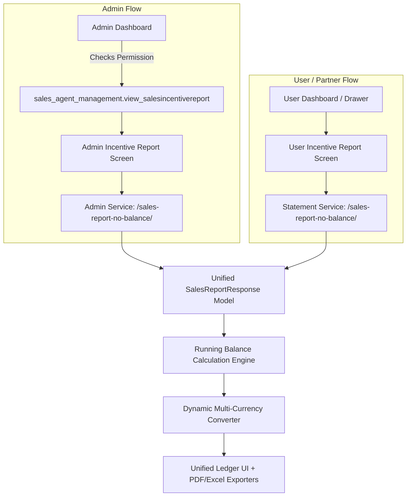

# Front-End Developer Guide: Incentive Report Implementation

This document provides a comprehensive technical and UI/UX specification for implementing the **Incentive Report** in the **SAASORDER PartnerPro** application. It details how both the **Admin Incentive Report** and **User (Partner) Incentive Report** are constructed, styled, and calculated so that any front-end developer can achieve identical behavior and design.

---

## 1. Executive Summary & Overview

The application features **two separate Incentive Report screens**:
1. **Admin Incentive Report** (`AdminIncentiveReportScreen`): Designed for managers/administrators to review historical commission ledgers, balance statements, and payouts across the platform.
2. **User Incentive Report** (`UserIncentiveReportScreen`): Designed for individual sales agents/partners to view their personal commission credits, debits (redemptions), and real-time running balance.

Both screens share an **identical visual design language, ledger hierarchy, card layout, and business logic**, differing primarily in their access permissions, API routing endpoints, and navigation context.



---

## 2. Admin vs. User Incentive Report: Comparison

| Feature | Admin Incentive Report | User / Partner Incentive Report |
| :--- | :--- | :--- |
| **File Location** | `lib/screens/admin/admin_incentive_report_screen.dart` | `lib/screens/user/user_incentive_report_screen.dart` |
| **Access Permission** | Requires JWT permission: `sales_agent_management.view_salesincentivereport` | Open to all authenticated partners/agents |
| **API Base URL** | Admin Base URL (`ApiConfig.getAdminFullUrl`) | Normal Portal Base URL (`ApiConfig.getFullUrl`) |
| **Endpoint** | `/api/v1/sales-agent-management/sales-report-no-balance/` | `/api/v1/sales-agent-management/sales-report-no-balance/` |
| **Query Parameters** | `?salesperson_id=<id>&from_date=YYYY-MM-DD&to_date=YYYY-MM-DD` | `?from_date=YYYY-MM-DD&to_date=YYYY-MM-DD` (Scoped to token) |
| **Riverpod Provider** | `salesReportProvider`, `salesReportDateRangeProvider` | `userSalesReportProvider`, `userSalesReportDateRangeProvider` |
| **Currency Provider**| `adminCurrencyProvider` | `userCurrencyProvider` |
| **Navigation Back** | Standard `Navigator.pop(context)` | `PopScope` switches to `ActiveScreen.dashboard` |

---

## 3. API Contract & Data Schema

### 3.1 Endpoint Details
- **Method:** `GET`
- **Path:** `/api/v1/sales-agent-management/sales-report-no-balance/`
- **Headers:**
  ```http
  Authorization: Bearer <JWT_ACCESS_TOKEN>
  Content-Type: application/json
  ```
- **Query Parameters:**
  - `salesperson_id` *(Admin only, optional)*: Filter report for a specific sales agent.
  - `from_date` *(Optional)*: Start date in `YYYY-MM-DD` format.
  - `to_date` *(Optional)*: End date in `YYYY-MM-DD` format.

### 3.2 Response Payload Example
```json
{
  "total_balance": 15450.00,
  "historical_total_credit": 25000.00,
  "total_debit": 9550.00,
  "salesperson_name": "John Doe",
  "salesperson_id": "SP-1024",
  "sales_report": [
    {
      "id": 101,
      "invoice_date": "2024-12-01",
      "approved_at": "2024-12-05",
      "invoice_reference_no": "INV-2024-001",
      "customer_name": "Acme Corp",
      "platform": "Shopify",
      "currency_amount": 1200.00,
      "credit": 120.00,
      "currency": "AED",
      "is_approved": true,
      "debit": 0.00,
      "balance": 0.00
    },
    {
      "id": 102,
      "invoice_date": "2024-12-10",
      "approved_at": null,
      "invoice_reference_no": "PAYOUT-550",
      "customer_name": "Direct Payout",
      "platform": "",
      "currency_amount": 0.00,
      "credit": 0.00,
      "currency": "AED",
      "is_approved": false,
      "debit": 500.00,
      "balance": 0.00
    }
  ]
}
```

### 3.3 Field Dictionary

| JSON Key | Target Model Field | Type | Description / Fallbacks |
| :--- | :--- | :--- | :--- |
| `total_balance` / `total_amount` | `totalAmount` | `double` | Overall available wallet balance in base currency (AED). |
| `historical_total_credit` / `total_credit` / `total_commission` | `totalCommission` | `double` | Lifetime earned commission (Credits). |
| `total_debit` | `totalDebit` | `double` | Lifetime redeemed/withdrawn commission (Debits). |
| `sales_report` / `orders` | `entries` | `List<SalesReportEntry>` | Chronological or reverse-chronological transaction entries. |
| `invoice_reference_no` | `invoiceReferenceNo`| `String` | Order invoice code or payout reference number. |
| `customer_name` | `customerName` | `String` | Customer/Client name associated with the invoice. |
| `platform` | `platform` | `String` | Platform tag (e.g., "Shopify", "WooCommerce"). Empty or `'False'` means none. |
| `currency_amount` / `total_amount` | `totalAmount` | `double` | Gross invoice amount. If `0.0`, displays "No Incentive". |
| `credit` / `commission_amount` | `commissionAmount` | `double` | Commission earned for this specific transaction. |
| `debit` | `debit` | `double` | Amount redeemed or deducted. |
| `approved_at` | `approvedAt` | `String` | Approval timestamp. Used as primary display date if valid. |
| `invoice_date` | `invoiceDate` | `String` | Invoice creation date. Used if `approved_at` is null/empty. |
| `is_approved` / `is_approve` | `isApproved` | `bool` | Approval state. Defaults to `true` if `approved_at` is present. |

---

## 4. Key Business Logic & Algorithms

### 4.1 Running Balance Algorithm (Reverse Accumulation)
The server returns transactions ordered **newest-first** (index `0` is the latest order, index `n - 1` is the oldest). However, the initial ledger balance starts at `0.0` at the **oldest transaction** and accumulates forward in time.

To calculate accurate running balances while preserving the display order:

```dart
static List<SalesReportEntry> calculateRunningBalances(List<SalesReportEntry> rawEntries) {
  if (rawEntries.isEmpty) return [];

  final balances = List<double>.filled(rawEntries.length, 0.0);
  double currentBalance = 0.0;

  // 1. Iterate backwards from oldest entry (end of list) to newest (index 0)
  for (int i = rawEntries.length - 1; i >= 0; i--) {
    final entry = rawEntries[i];
    // Credit increases balance, Debit decreases balance
    currentBalance += (entry.commissionAmount - entry.debit);
    balances[i] = double.parse(currentBalance.toStringAsFixed(2));
  }

  // 2. Attach the calculated balance to each entry
  return List.generate(
    rawEntries.length, 
    (i) => rawEntries[i].copyWith(balance: balances[i]),
  );
}
```

### 4.2 Preferred Display Date (`displayDate`)
A transaction's timeline status is determined by:
1. If `approvedAt` is non-null, non-empty, and not `"False"`, use `approvedAt` as the primary date.
2. Otherwise, fall back to `invoiceDate` and mark the item as **"(Pending)"**.

### 4.3 Multi-Currency Conversion
- All numbers from the server are in **AED** (United Arab Emirates Dirham).
- A currency selector dropdown in the AppBar allows the user to switch between currencies (`AED`, `USD`, `INR`, `SAR`, `OMR`, etc.).
- Every numeric figure displayed on the UI (Total Balance, Total Credit, Total Debit, Line Credit, Line Debit, and Running Balance) is dynamically passed through `CurrencyUtils.convertAmount(amount, 'AED', targetCurrency)`.

---

## 5. UI Architecture & Component Hierarchy

The screen uses a **Sliver-based CustomScrollView** wrapped in a `RefreshIndicator` and `AnimatedSwitcher` for smooth state transitions.

```text
Scaffold (Background: #F8F9FA)
│
├── AppBar (Background: #032267)
│   ├── Leading: Back button
│   ├── Title: Supertitle 'SAASORDER' (11px, bold, 70% white)
│   │          Title 'Incentive Report' (18px, bold, white)
│   └── Actions: Currency Dropdown (height 38px, pill border)
│
└── RefreshIndicator -> CustomScrollView
    ├── SliverToBoxAdapter: Top KPI Summary Cards (Horizontal Scroll)
    ├── SliverToBoxAdapter: Date Range Filter & Export Button Bar
    ├── SliverToBoxAdapter: Section Header ('Order Details (count)') + Column Titles
    └── SliverList: Ledger Cards (with FadeInSlide staggered entrance animation)
```

---

## 6. Detailed Component Specifications

### 6.1 Design Tokens (Color Palette)
- **Primary Navy Blue**: `#032267` (Used for AppBar, Primary CTA, Balance Pills, Active Icons)
- **Secondary Indigo**: `#2C3E9F`
- **Credit Green (Text/Icon)**: `#67C23A` / `#2E7D32`
- **Credit Green (Background Tint)**: `#F0F9EB`
- **Debit Red (Text/Icon)**: `#F56C6C` / `#C62828`
- **Debit Red (Background Tint)**: `#FEF0F0`
- **Pending Orange**: `#F57C00` / `#FFF3E0`
- **Card Background**: `#FFFFFF` with border `1px solid #E0E0E0` or `#EEEEEE`
- **Screen Background**: `#F8F9FB` / `AppColors.backgroundLight`

---

### 6.2 Component 1: Top KPI Summary Row (`SummaryRowWidget`)
Horizontal scrollable list (`height: 110px`, card `width: 155px`):

1. **Available Balance Card**:
   - **Icon**: `Icons.account_balance_wallet_rounded` in circular navy tint container (`#032267`, 10% opacity).
   - **Subtitle**: `"Available Balance"` (11px, grey-600).
   - **Value**: `${displayCurrency} ${convertedBalance}` (16px, bold, grey-900).
   - **Accent Dot**: Navy blue.
2. **Total Credit Card**:
   - **Icon**: `Icons.arrow_downward_rounded` in circular green tint container (`Colors.green.shade600`, 10% opacity).
   - **Subtitle**: `"Total Credit"` (11px, grey-600).
   - **Value**: `${displayCurrency} ${convertedCredit}` (16px, bold, grey-900).
   - **Accent Dot**: Green.
3. **Total Debit Card**:
   - **Icon**: `Icons.arrow_upward_rounded` in circular orange tint container (`Colors.orange.shade700`, 10% opacity).
   - **Subtitle**: `"Total Debit"` (11px, grey-600).
   - **Value**: `${displayCurrency} ${convertedDebit}` (16px, bold, grey-900).
   - **Accent Dot**: Orange.

---

### 6.3 Component 2: Date Filter & Export Bar (`DateFilterRow`)
Contained in a white card with `borderRadius: 16px` and subtle shadow:

- **From Date & To Date Pickers**:
  - Tapping either opens the system `showDateRangePicker`.
  - Displays `"From Date"` caption (11px) and input box containing calendar icon + date text formatted as `DD MMM YYYY` (e.g., `01 Dec 2024`). Defaults to `"All"` when cleared.
- **Reset Button**:
  - Appears only when a date range is actively applied.
  - Circular/square icon button with reset icon (`Icons.refresh_rounded`) on light navy background. Clears the filter.
- **Export Menu Button (`PopupMenuButton`)**:
  - Dark Navy button (`#032267`, borderRadius 8px) with download icon and `"Export"` label.
  - Dropdown options:
    1. **Excel Spreadsheet** (`.xlsx`): green Excel icon, subtitle `"Export as .xlsx file"`.
    2. **PDF Document** (`.pdf`): red PDF icon, subtitle `"Export as printable .pdf file"`.

---

### 6.4 Component 3: Section Header & Ledger Column Titles
Above the ledger list:
1. **Title**: `"Order Details"` (16px, bold, `#032267`) with count `"(X)"` (14px, bold).
2. **Column Bar**:
   - Left: `"ENTRIES"` (12px, bold, grey-500, letter-spacing 0.5).
   - Right: Two fixed-width column titles matching card right-side columns:
     - `REDEEMED` (width: `100px`, centered, 11px bold, `#C62828`).
     - `COMMISSION` (width: `100px`, centered, 11px bold, `#2E7D32`).

---

### 6.5 Component 4: Transaction Ledger Card (`SalesReportCard`)
A white card with `borderRadius: 12px`, `border: 1px solid #E0E0E0`, and an interactive accordion (`AnimatedCrossFade`) toggled on tap.

#### A. Collapsed State (Default View)
Divided into two horizontal zones:
- **Left Zone (Date & Running Balance)**:
  - **Date Line**:
    - If approved: Calendar icon (`#032267`, 14px) + formatted date (e.g., `15 Dec 2024`, 12px, grey-600).
    - If pending: Orange clock icon + formatted invoice date + `(Pending)` in orange bold text (`#E65100`).
  - **Running Balance Pill**:
    - Dark navy pill (`#032267`, borderRadius 6px, padding `8px horizontal, 4px vertical`).
    - Text: `BAL: AED 1,250.00` (10px, bold, white).
- **Right Zone (Fixed 2 Columns - 100px each)**:
  - **Redeemed (Debit)** Box:
    - Width `100px`, height `44px`, rounded 8px.
    - If `debit > 0`: Light red background (`#FEF0F0`), text in red bold (`#F56C6C`, 12px): `AED 200.00`.
    - If `debit == 0`: Transparent background, empty.
  - **Commission (Credit)** Box:
    - Width `100px`, height `44px`, rounded 8px.
    - If `credit > 0`: Light green background (`#F0F9EB`), text in green bold (`#67C23A`, 12px): `AED 150.00`.
    - If `credit < 0`: Light red background (`#FEF0F0`), text in red bold (`#F56C6C`, 12px).
    - If `credit == 0`: Transparent background, empty.

#### B. Expanded State (Detailed Dropdown Pane)
Reveals a nested container with background `#FAFAFA`, radius `12px`, and key-value detail rows:

| Label (Width 100px, Grey-500) | Value Styling |
| :--- | :--- |
| **Customer** | 12px, bold, black87 |
| **Platform** | Rendered as a pill chip (`#032267` text with 6% navy tint background, uppercase) |
| **Invoice Date** | 12px, regular, black87 (`DD MMM YYYY`) |
| **Approved Date** | 12px, regular, black87 (`DD MMM YYYY`), omitted if not approved |
| **Invoice Ref** | 12px, regular, black87 (e.g., `INV-2024-001`) |
| **Invoice Amount** | 12px, regular (`AED 1,200.00`). If `0.0`, displays **"No Incentive"** in red |
| **Status** | Status badge pill: Green `"Approved"` (`#2E7D32`) or Orange `"Pending"` (`#E65100`) |
| **Running Balance** | 12px, bold, navy `#032267` |

---

## 7. Export Generation Specifications

Both reports use the shared utility `IncentiveReportExporter.exportReport(...)`:

### 7.1 PDF Export Requirements
- **Orientation:** Landscape A4.
- **Top Header:** Branded banner with `#032267` background, title `"INCENTIVE REPORT"`, generated timestamp, and target currency.
- **Summary Cards:** 3 summary blocks at top: Available Balance, Total Credit, Total Debit.
- **Ledger Table Columns:**
  `#` | `Date` | `Invoice Ref` | `Customer` | `Platform` | `Invoice Amount` | `Status` | `Redeemed (Debit)` | `Commission (Credit)` | `Running Balance`
- **Cell Styling:**
  - Status badges with light green/orange backgrounds.
  - Redeemed column colored in red `#C62828`.
  - Commission column colored in green `#2E7D32`.
- **Footer:** Confidentiality notice on left, `Page X of Y` on right.

### 7.2 Excel (.xlsx) Export Requirements
- **Metadata:** Report title and creation date in merged top rows with corporate styling.
- **Summary Block:** Key KPI cards formatted with currency formatting (`$#,##0.00` or numeric with 2 decimals).
- **Data Columns:** Formatted headers, alternating row colors, auto-fit column widths, explicit column headers matching the PDF table.

---

## 8. State Transitions & Edge Cases

1. **Loading State (`LoadingSkeleton`)**:
   - Renders 3 skeleton cards with an animated opacity loop (shimmer effect between `0.3` and `0.7` opacity over 1000ms).
2. **Empty State (`EmptyState`)**:
   - Displayed when `entries.isEmpty` (e.g., after date filtering or no records exist).
   - Shows circular grey folder icon (`Icons.folder_open_outlined`), title `"No incentive reports found"`, subtitle explaining the filter, and a `"Refresh"` button in primary blue.
3. **Error State (`ErrorState`)**:
   - Displayed when network or server returns an error.
   - Shows red alert box (`#FEF0F0`), error message, and a `"Retry"` button.
4. **Pull-to-Refresh**:
   - Uses `RefreshIndicator` on the root scroll view to invalidate and re-execute the respective provider future.

---

## 9. Quick Reference Checklist for Front-End Developer

- [ ] **Dual Screen Structure:** Implement separate screens for Admin and User portals while reusing the same ledger component.
- [ ] **Reverse Balance Loop:** Ensure running balance is calculated from oldest to newest before rendering.
- [ ] **Date Precedence:** Use `approvedAt` first; fall back to `invoiceDate` with `(Pending)` tag.
- [ ] **Fixed Width Columns:** Keep `REDEEMED` and `COMMISSION` header and card boxes aligned at exactly `100px` each.
- [ ] **Zero Handling:** Display blank space (not `$0.00`) in the collapsed card columns when debit or credit is zero.
- [ ] **Zero Invoice Amount:** If `currency_amount` is `0.0`, display `"No Incentive"` in red instead of `$0.00`.
- [ ] **Multi-Currency:** Convert all numbers from AED using the selected currency before formatting to 2 decimal places.
- [ ] **Accordion:** Ensure card expansion only triggers when tapped and animates smoothly.
